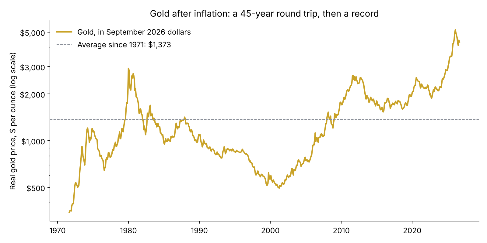

# Is gold an inflation hedge? Free-market gold vs US inflation, 1971–2026

Gold is the asset most often bought "for inflation", and its price has just set records. This project tests the claim on 55 years of monthly data since the US closed the gold window in August 1971: how often gold beat inflation, when it paid, how closely it tracked inflation, and what today's real price has meant for the following decade.

## Results

- **Not a reliable hedge over investors' horizons.** Gold beat US inflation in 55% of rolling 1-year windows and 57% of 10-year windows (US stocks 91%, 10-year Treasuries 83%). The worst 10 years lost 9.8% a year after inflation. In real terms gold fell 83% from January 1980 to April 2001 and only regained its 1980 level in February 2025, 45 years later.
- **Not one-for-one.** In calendar years, gold rose 3.75 points for each point of inflation (t = 3.4), but with a correlation of only 0.43: a noisy, leveraged response, not a match for an inflation-linked liability. Pre-registered H2 rejected.
- **It paid in the inflation year itself.** In the 16 years with inflation above 4%, gold returned +9.8% after inflation, against +0.8% for stocks and −3.7% for Treasuries. Bought after a high-inflation year, gold returned +5.0% the next year: still ahead of stocks (+1.8%) and Treasuries (+1.2%), but about half the payoff.
- **Today's price is outside history.** In September 2026 dollars gold is at $4,319, 3.1 times its 1971–2026 average ($1,373) and above its January 1980 peak; it reached 3.8 times in February 2026. Months in the dearest fifth (median 1.4 times the average) were followed by a median real return of +0.8% a year over the next 10 years, against +11.3% for the cheapest fifth (correlation −0.60, but only four independent decades). No month before 2017 was above 2.1 times.



## The commercial case

| Element | What it is |
|---|---|
| Who pays | Pension and endowment CIOs, wealth platforms and insurers setting real-asset or inflation-hedge allocations |
| The problem | Gold is sized as an inflation hedge; it missed inflation in 43% of 10-year windows and spent 45 years below its 1980 real peak |
| The product | An inflation-hedge scorecard: each candidate asset's hit rate against inflation by horizon, its inflation beta, its payoff by regime and its valuation |
| Proof | 55 years of monthly data; hypotheses and bands fixed in advance |
| Build vs buy | 2–3 weeks on public data; today most committees rely on narrative and recent performance |
| Pricing logic | $25–40k a year per client (illustrative): a 5% gold sleeve in a $1bn portfolio is $50m; the 1980–2001 real drawdown would have cost $41.5m of purchasing power |
| Adoption risk | Gold's recent run makes evidence on valuation unwelcome; the KPI is real return of the inflation sleeve against its liability |

## Method

1. Monthly gold price (World Bank Pink Sheet and Timothy Green series via `datasets/gold-prices`), BLS CPI-U, Shiller's S&P 500 with dividends (SPY after 2023) and a 10-year par Treasury, September 1971 to September 2026. October 2025 CPI was not published; it is filled log-linearly.
2. Overlapping 1-, 5-, 10- and 20-year windows: share beating inflation, median and worst real return, correlation with inflation.
3. Calendar-year regression of gold's return on inflation (beta).
4. Calendar years grouped by inflation (below 2.5%, 2.5–4%, above 4%, fixed in advance), both the same year and the year before.
5. Real gold price relative to its 1971–2026 average (and an expanding average) against the following 10-year real return.

## Run it

```
pip install -r requirements.txt
make ingest   # downloads the public files and checks sha256
make run      # reports/metrics.json and reports/figures/*.png
make test
```

## Limits

- Gold prices are monthly averages, which smooth short-term moves; the dates of peaks and troughs are approximate.
- Overlapping windows are not independent: 55 years hold only five non-overlapping decades.
- The valuation ratio uses the full-sample average (an expanding average gives a similar −0.47 correlation); today's 3.1 times is outside the range of the history.
- US inflation and a US investor's perspective only; no storage, insurance or fund costs.
- Independent research on public data; not deployed; not investment advice.

## Data and licences

- Gold monthly prices: [github.com/datasets/gold-prices](https://github.com/datasets/gold-prices) (ODC-PDDL), compiled from the World Bank Commodity Price Data (Pink Sheet) and the Timothy Green historical table (National Mining Association).
- BLS CPI-U: [github.com/datasets/cpi-us](https://github.com/datasets/cpi-us) (ODC-PDDL).
- Shiller S&P 500 and long rate: [github.com/datasets/s-and-p-500](https://github.com/datasets/s-and-p-500) (ODC-PDDL).
- Treasury par yields, SPY prices and dividends: [huggingface.co/datasets/defeatbeta/yahoo-finance-data](https://huggingface.co/datasets/defeatbeta/yahoo-finance-data) (ODC-BY).
- All pinned by sha256 in `configs/default.yaml`.

## References

- Erb, C. B. and Harvey, C. R. (2013), "The Golden Dilemma," *Financial Analysts Journal* 69(4).
- Baur, D. G. and Lucey, B. M. (2010), "Is Gold a Hedge or a Safe Haven? An Analysis of Stocks, Bonds and Gold," *Financial Review* 45(2).

Code MIT-licensed. Code, analysis, charts and text were produced with AI assistance (Claude, by Anthropic) and reviewed by Gaurav Gupta.
